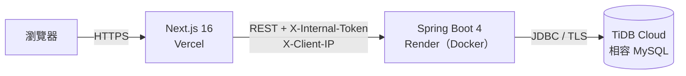

# 明野照明 LUMENFIELD — 產品展示與詢價網站

照明公司的雙語官網：產品型錄、設計案例、免登入詢價清單，以及管理者後台。
後端以 Spring Boot 4 撰寫，上線前做過完整的資安測試，部署在免費雲端方案上。

A bilingual (zh-TW / en) product showcase and inquiry site for a fictional lighting company,
with a Next.js front end and a Spring Boot API.

| | |
|---|---|
| 線上 demo | **https://lumenfield-chi.vercel.app** |
| 後台 | [`/admin`](https://lumenfield-chi.vercel.app/admin)，唯讀帳號 `demo`／`lumenfield-demo`：看得到所有畫面，但不能存檔，詢價的聯絡資料會遮罩 |
| 注意 | 後端在免費主機上，閒置後第一次送出詢價或開後台要等 30～60 秒喚醒 |

> 專案源自一間照明公司的實際需求，公開版改用**虛構品牌**明野照明（LUMENFIELD）。產品、案例與聯絡資訊皆為虛構；案例照片來自 Unsplash，來源見 [`frontend/public/demo/CREDITS.md`](frontend/public/demo/CREDITS.md)。

## 亮點

**後端 API 與權限**
- Spring Boot 4、Java 21 REST API；資料表由 Flyway migration 管理，不用 Hibernate 自動建表
- Spring Security Session 登入，兩種角色：管理者（ADMIN）可讀寫、唯讀（VIEWER）只能看
- 登入失敗依「IP＋帳號」計次鎖定；登入時換新 Session（防 session fixation）
- 唯讀帳號取得的詢價資料會遮罩聯絡人、Email、電話

**上線前資安測試**（[完整紀錄](docs/SECURITY_REVIEW.md)）
- 自行測試 23 項：權限、路徑穿越、SQL injection、惡意上傳、XSS、信件標頭注入、套件弱點等
- 找出並修正 8 個問題，例如：
  - 任何人都能故意輸錯把帳號鎖住
  - 詢價沒有上限，可以洗版塞爆資料庫
  - 公開 demo 後台看得到其他訪客的個資
- 後端只接受 Next 伺服器的請求（共用密鑰＋固定時間比較）；訪客 IP 由 Next 轉送，只有帶正確密鑰的請求才採信
- 上傳檔案檢查副檔名白名單＋檔頭（magic bytes），非圖片一律以下載方式輸出

**測試**
- 57 個整合測試：JUnit 5、MockMvcTester、Testcontainers，連真的 MySQL
- 涵蓋 API、權限、資料驗證、上傳檢查、migration、資安防護

**部署**
- 後端 Docker 化（多階段建置），部署在 Render 免費方案；在 512MB 記憶體內調校 JVM，執行時約用 240MB
- 資料庫用 TiDB Cloud（相容 MySQL）；部署前先在本機以 TiDB 容器驗證 migration 相容性
- 前端部署在 Vercel，push 到 `main` 前後端自動重新部署

## 架構



- 瀏覽器只連 Next.js；Next.js 在伺服器端呼叫 Spring Boot API，權限一律由後端驗證。
- 後台登入用後端 Session：JSESSIONID 由 Next 存成 httpOnly cookie（只送 `/admin`），瀏覽器拿不到也碰不到後端。
- 前台資料以 Next.js `"use cache"` 快取；後台存檔時用 `updateTag` 清掉快取，前台立即更新。

## 設計取捨

| 決定 | 理由 |
|---|---|
| Session 而非 JWT | 只有 Next 伺服器會呼叫後端，不需要無狀態的 token；Session 可以立即登出、作廢 |
| 瀏覽器不直接連後端 | 不用處理 CORS；後端網址公開也沒關係，因為只接受帶密鑰的請求 |
| 鎖定與限量依 IP | 只依帳號的話，任何人故意輸錯就能把管理者鎖在門外 |
| 型號、品名由後端產生快照 | 詢價單只收產品 id 與數量，不信任前端送來的型號與名稱 |
| 免費方案組合 | Vercel＋Render＋TiDB Cloud 都不用付費；代價是冷啟動與上傳檔不保存，寫在 [`DEPLOY.md`](docs/DEPLOY.md) |

完整的技術選型理由見 [`docs/ADR-001-tech-stack.md`](docs/ADR-001-tech-stack.md)。

## 功能

**前台**
- 繁中／英文雙語，網址區分語系（`/zh-TW`、`/en`）
- 產品依燈型、空間分類篩選，規格表、型錄／IES／CAD 下載
- 設計案例：台灣縣市地圖篩選、年份與分類篩選、照片燈箱
- 詢價清單：不需登入，存在瀏覽器；送出後產生詢價編號（`INQ-yyyyMMdd-NNNN`），並寄通知信給業務
- 亮色／暗色主題

**後台**（`/admin`）
- 帳號密碼登入（後端 Session、登入失敗鎖定）
- 產品、案例新增與編輯，照片／檔案上傳、排序
- 詢價列表與明細
- 存檔後前台立即更新（Next.js `updateTag`）

## 技術

| | |
|---|---|
| 後端 | Spring Boot 4.1、Java 21、Spring Security、Spring Data JPA、Flyway |
| 資料庫 | MySQL 8.4（本機）、TiDB Cloud（線上） |
| 測試 | JUnit 5、MockMvcTester、Testcontainers |
| 前端 | Next.js 16（App Router、Cache Components、Server Actions）、React、TypeScript、Tailwind CSS 4、next-intl |
| 部署 | Docker、Render、Vercel |
| 開發環境 | Docker Compose（MySQL、Mailpit） |

## 本機執行

需要 Node.js 24、Java 21、Maven 3.9、Docker Desktop。

```bash
cd backend
mvn spring-boot:run
```

後端在 http://localhost:8080，會自動用 Docker 啟動 MySQL 與 Mailpit，並載入開發用假資料。

```bash
cd frontend
npm install
npm run dev
```

| 網址 | 內容 |
|---|---|
| http://localhost:3000 | 網站 |
| http://localhost:3000/admin | 後台（帳號 `admin`／密碼 `lf-admin-dev-only`，只在開發環境） |
| http://localhost:8025 | Mailpit：查看詢價通知信（不會真的寄出） |

測試：`cd backend && mvn test`（Testcontainers 會另起一個暫時的 MySQL）。

## 文件

| 文件 | 內容 |
|---|---|
| [`docs/SPEC.md`](docs/SPEC.md) | 需求規格 |
| [`docs/SITEMAP.md`](docs/SITEMAP.md) | 網站地圖與頁面內容 |
| [`docs/DATA_MODEL.md`](docs/DATA_MODEL.md) | 資料模型 |
| [`docs/DESIGN_SYSTEM.md`](docs/DESIGN_SYSTEM.md) | 設計規範 |
| [`docs/ADR-001-tech-stack.md`](docs/ADR-001-tech-stack.md) | 技術選型與決策紀錄 |
| [`docs/DEPLOY.md`](docs/DEPLOY.md) | 公開 demo 的部署方式（Vercel＋Render＋TiDB Cloud） |
| [`docs/SECURITY_REVIEW.md`](docs/SECURITY_REVIEW.md) | 上線前資安測試紀錄 |
