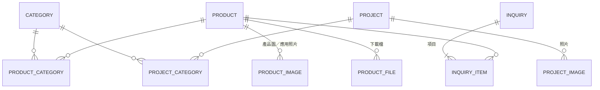

# 資料模型（DATA_MODEL）

> 版本：v0.1（階段 0 草案）
> 依據：`docs/SPEC.md` v0.1
> 用途：前端假資料的 TypeScript 型別、後端 JPA Entity / DTO 都以本文件為準。

---

## 1. 設計原則

1. **雙語**：需翻譯的文字欄位統一用 `LocalizedText = { zh, en }`。
   - 前端：`{ zh: string; en: string }`
   - 後端：JPA `@Embeddable`，資料表展開為兩欄（如 `name_zh`、`name_en`）
   - 取捨：語系固定兩種，展開欄位最簡單、好查詢；日後若加第三語系需 migration，可接受。
2. **主鍵**：`id`（Long，自動遞增），僅供系統內部使用。
3. **網址**：產品、案例另有 `slug`（唯一、英文小寫加連字號），用於 SEO 友善網址，例如 `/zh-TW/products/lf-dl-01`。
4. **時間戳**：所有主要資料表皆有 `createdAt`、`updatedAt`。
5. **詢價留快照**：詢價項目會複製當下的型號與名稱，日後產品被修改，舊詢價紀錄不受影響（也是日後轉訂單的必要條件）。

## 2. 關聯圖



## 3. 實體

### 3.1 Category（分類）

| 欄位 | 型別 | 雙語 | 必填 | 說明 |
|---|---|---|---|---|
| id | Long | | ✓ | |
| type | Enum | | ✓ | `LIGHT_TYPE`（燈型）／`SPACE`（空間）：產品用，對應產品頁兩個 Tab；`PROJECT`（案例分類）：案例用 |
| slug | String | | ✓ | 同一 type 內唯一 |
| name | LocalizedText | ✓ | ✓ | |
| sortOrder | Integer | | ✓ | 顯示順序 |

> 一款產品可同時屬於多個燈型分類與多個空間分類（多對多，`product_category`）。
> `TODO` 燈型、空間實際分類項目待確認。
> 案例分類 6 類：燈節與光影策展、公共藝術與地景、街區營造與造街、歷史古蹟與宮廟、商業空間與校園、其他照明專案（多對多，`project_category`）。

### 3.2 Product（產品）

| 欄位 | 型別 | 雙語 | 必填 | 說明 |
|---|---|---|---|---|
| id | Long | | ✓ | |
| slug | String | | ✓ | 唯一 |
| modelNo | String | | ✓ | 型號，唯一 |
| name | LocalizedText | ✓ | ✓ | 名稱 |
| wattage | String | | | 瓦數，如 `12W`、`9W / 12W` |
| colorTemperature | String | | | 色溫，如 `3000K / 4000K` |
| dimensions | String | | | 尺寸，如 `Ø90 × H120 mm` |
| ipRating | String | | | IP 等級，如 `IP65` |
| price | Decimal | | | 價格（新台幣） |
| priceVisible | Boolean | | ✓ | `true` 顯示價格；`false` 顯示「詢價」 |
| categories | Category[] | | | 多對多 |
| images | ProductImage[] | | | 產品圖，多張，依 sortOrder 排序，第一張為主圖 |
| applicationImages | ProductImage[] | | | 應用案例照片，多張（與設計案例無關，見 3.5） |
| files | ProductFile[] | | | 型錄 PDF、IES、CAD |

> 規格欄位先用 String：同一型號常有多種瓦數／色溫可選，字串最有彈性。若日後需要依瓦數篩選，再拆成數值欄位。

### 3.3 ProductImage（產品圖片）

| 欄位 | 型別 | 雙語 | 必填 | 說明 |
|---|---|---|---|---|
| id | Long | | ✓ | |
| productId | Long | | ✓ | |
| url | String | | ✓ | |
| alt | LocalizedText | ✓ | | 替代文字（SEO、無障礙） |
| kind | Enum | | ✓ | `PRODUCT`（產品圖）／`APPLICATION`（應用照片） |
| sortOrder | Integer | | ✓ | 同一 kind 內排序 |

### 3.4 ProductFile（產品下載檔）

| 欄位 | 型別 | 雙語 | 必填 | 說明 |
|---|---|---|---|---|
| id | Long | | ✓ | |
| productId | Long | | ✓ | |
| kind | Enum | | ✓ | `CATALOG_PDF`／`IES`／`CAD` |
| url | String | | ✓ | |
| fileName | String | | ✓ | 下載時顯示的檔名 |
| sizeBytes | Long | | | 顯示檔案大小用 |

### 3.5 Project（設計案例）

| 欄位 | 型別 | 雙語 | 必填 | 說明 |
|---|---|---|---|---|
| id | Long | | ✓ | |
| slug | String | | ✓ | 唯一 |
| title | LocalizedText | ✓ | ✓ | 案例名稱 |
| description | LocalizedText | ✓ | | 案例介紹（主辦機關等資訊先寫在這裡） |
| year | Integer | | ✓ | 專案年份，如 `2026` |
| categories | Category[] | | | `type = PROJECT`，可多個 |
| location | LocalizedText | ✓ | ✓ | 顯示用地點，如「嘉義縣新港鄉」 |
| countyCode | Enum | | ✓ | 所在縣市，ISO 3166-2:TW 代碼（如 `TW-CYQ` 嘉義縣），地圖依此分區 |
| latitude | Decimal | | | 緯度；有填才在地圖顯示光點 |
| longitude | Decimal | | | 經度；有填才在地圖顯示光點 |
| images | ProjectImage[] | | | 多張，第一張為封面 |

**ProjectImage**：id、projectId、url、alt、sortOrder（無 kind）。

> **已決定（方案 B）**：設計案例是大型工程作品集，與產品無關聯。
> 產品的應用案例照片直接存在產品底下（`ProductImage.kind = APPLICATION`）。

> **地點**：地圖以縣市區塊為主（`countyCode` 必填）；經緯度選填，有填的案例另顯示光點，座標可日後陸續補。
> 跨縣市案例以主辦機關所在縣市為準。

**縣市代碼（ISO 3166-2:TW）**

| 代碼 | 縣市 | 代碼 | 縣市 |
|---|---|---|---|
| TW-KEE | 基隆市 | TW-CYI | 嘉義市 |
| TW-TPE | 臺北市 | TW-CYQ | 嘉義縣 |
| TW-NWT | 新北市 | TW-TNN | 臺南市 |
| TW-TAO | 桃園市 | TW-KHH | 高雄市 |
| TW-HSZ | 新竹市 | TW-PIF | 屏東縣 |
| TW-HSQ | 新竹縣 | TW-ILA | 宜蘭縣 |
| TW-MIA | 苗栗縣 | TW-HUA | 花蓮縣 |
| TW-TXG | 臺中市 | TW-TTT | 臺東縣 |
| TW-CHA | 彰化縣 | TW-PEN | 澎湖縣 |
| TW-NAN | 南投縣 | TW-KIN | 金門縣 |
| TW-YUN | 雲林縣 | TW-LIE | 連江縣 |

### 3.6 Inquiry（詢價單）

| 欄位 | 型別 | 雙語 | 必填 | 說明 |
|---|---|---|---|---|
| id | Long | | ✓ | |
| inquiryNo | String | | ✓ | 對外編號，如 `INQ-20261103-0001`，寫在通知信中 |
| contactName | String | | ✓ | `TODO` 欄位待確認 |
| companyName | String | | | `TODO` |
| email | String | | ✓ | `TODO` |
| phone | String | | | `TODO` |
| message | String | | | `TODO` 備註 |
| locale | Enum | | ✓ | `zh`／`en`，送出時的語系，方便回覆 |
| items | InquiryItem[] | | ✓ | 至少 1 項 |
| createdAt | DateTime | | ✓ | |

> 不需登入，聯絡資訊直接存在詢價單上。

### 3.7 InquiryItem（詢價項目）

| 欄位 | 型別 | 雙語 | 必填 | 說明 |
|---|---|---|---|---|
| id | Long | | ✓ | |
| inquiryId | Long | | ✓ | |
| productId | Long | | | 指向產品；產品日後若刪除，此欄可為空 |
| modelNoSnapshot | String | | ✓ | 送出當下的型號 |
| productNameSnapshot | LocalizedText | ✓ | ✓ | 送出當下的名稱 |
| quantity | Integer | | ✓ | ≥ 1 |

### 3.8 AdminUser（後台管理者）

| 欄位 | 型別 | 雙語 | 必填 | 說明 |
|---|---|---|---|---|
| id | Long | | ✓ | |
| username | String | | ✓ | 唯一 |
| passwordHash | String | | ✓ | BCrypt 雜湊，不存明碼 |

> 依 SPEC 第 8 節「後台需登入」而設。`TODO` 帳號數量與權限細節待討論。

## 4. 前台詢價清單（未送出前）

- 存在瀏覽器 `localStorage`，不經後端；結構為 `{ productId, quantity }[]`。
- 送出時才建立 Inquiry + InquiryItem。

## 5. 遠期擴充：詢價 → 訂單

現階段**不實作**，僅說明目前結構如何延伸：

| 現在 | 遠期 |
|---|---|
| 前台詢價清單（localStorage） | 購物車（同結構，可加上登入後存到後端） |
| Inquiry | Order：加上訂單狀態、金額合計、付款資訊、會員（Customer） |
| InquiryItem（含快照） | OrderItem：再加 `unitPriceSnapshot`、小計 |
| Product.price / priceVisible | 直接沿用 |

因為詢價項目已有快照設計，轉成訂單時不需要改動既有資料。

## 6. TypeScript 型別示意

```ts
export type Locale = 'zh' | 'en';
export type LocalizedText = Record<Locale, string>;

export type CategoryType = 'LIGHT_TYPE' | 'SPACE' | 'PROJECT';

export type CountyCode =
  | 'TW-KEE' | 'TW-TPE' | 'TW-NWT' | 'TW-TAO' | 'TW-HSZ' | 'TW-HSQ'
  | 'TW-MIA' | 'TW-TXG' | 'TW-CHA' | 'TW-NAN' | 'TW-YUN' | 'TW-CYI'
  | 'TW-CYQ' | 'TW-TNN' | 'TW-KHH' | 'TW-PIF' | 'TW-ILA' | 'TW-HUA'
  | 'TW-TTT' | 'TW-PEN' | 'TW-KIN' | 'TW-LIE';
export type ProductFileKind = 'CATALOG_PDF' | 'IES' | 'CAD';

export interface Category {
  id: number;
  type: CategoryType;
  slug: string;
  name: LocalizedText;
  sortOrder: number;
}

export interface Image {
  id: number;
  url: string;
  alt?: LocalizedText;
  sortOrder: number;
}

export interface ProductFile {
  id: number;
  kind: ProductFileKind;
  url: string;
  fileName: string;
  sizeBytes?: number;
}

export interface Product {
  id: number;
  slug: string;
  modelNo: string;
  name: LocalizedText;
  wattage?: string;
  colorTemperature?: string;
  dimensions?: string;
  ipRating?: string;
  price?: number;
  priceVisible: boolean;
  categoryIds: number[];
  images: Image[];
  applicationImages: Image[];
  files: ProductFile[];
}

export interface Project {
  id: number;
  slug: string;
  title: LocalizedText;
  description?: LocalizedText;
  year: number;
  categoryIds: number[];
  location: LocalizedText;
  countyCode: CountyCode;
  latitude?: number;
  longitude?: number;
  images: Image[];
}

export interface InquiryItem {
  id: number;
  productId?: number;
  modelNoSnapshot: string;
  productNameSnapshot: LocalizedText;
  quantity: number;
}

export interface Inquiry {
  id: number;
  inquiryNo: string;
  contactName: string;
  companyName?: string;
  email: string;
  phone?: string;
  message?: string;
  locale: Locale;
  items: InquiryItem[];
  createdAt: string; // ISO 8601
}
```

> Inquiry 型別於 2026-11-03 補上（後台詢價查看用）；欄位仍待確認。

## 7. TODO／待確認

- [ ] `TODO` 燈型、空間分類的實際項目
- [ ] `TODO` 詢價表單欄位
- [ ] `TODO` 產品是否需要描述文字（SPEC 欄位清單未列）
- [ ] `TODO` 產品是否需要「上架／下架」狀態（SPEC 未列）
- [ ] `TODO` 後台帳號數量與權限
